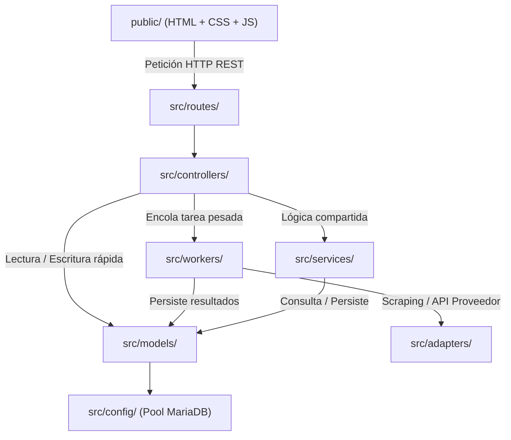

# Estructura de Carpetas y Arquitectura del Proyecto

Este documento describe la organización de directorios de **App-Farmacia**, diseñada bajo una **Arquitectura Modular en Capas con Procesamiento Asíncrono**.

---

## 1. Diagrama del Árbol de Directorios

```text
App-Farmacia/
├── public/                     # CAPA DE PRESENTACIÓN (Frontend liviano)
│   ├── css/                    # Hojas de estilo (ej. Pico.css, estilos propios)
│   ├── js/                     # Lógica Vanilla JS del cliente (fetch API, eventos DOM)
│   └── index.html              # Vista principal de la aplicación
│
├── src/                        # CÓDIGO FUENTE DEL BACKEND (Node.js + Fastify)
│   ├── config/                 # Configuraciones globales (Pool MariaDB, env, colas)
│   ├── routes/                 # Definición de endpoints de la API REST
│   ├── controllers/            # Controladores HTTP ligeros (validan y delegan/encolan)
│   ├── models/                 # Acceso a datos y consultas SQL hacia MariaDB
│   ├── services/               # Lógica de negocio transversal (SII, cifrado, utilidades)
│   ├── adapters/               # Conectores aislados por cada droguería / proveedor
│   ├── workers/                # Procesos asíncronos en 2° plano (Playwright, cronjobs)
│   └── app.js                  # Punto de entrada y arranque del servidor Fastify
│
├── node_modules/               # Dependencias instaladas por NPM (ignorado en Git)
├── .env                        # Variables de entorno secretas (ignorado en Git)
├── .gitignore                  # Reglas de exclusión para el control de versiones Git
└── package.json                # Manifiesto del proyecto, dependencias y scripts NPM
```

---

## 2. Flujo entre Capas



---

## 3. Detalle y Propósito de Cada Carpeta

### Capa de Presentación (`public/`)
Servida directamente por Fastify mediante `@fastify/static` sin necesidad de servidores web adicionales en desarrollo.

| Carpeta / Archivo | ¿Para qué sirve? | Ejemplos de archivos |
| :--- | :--- | :--- |
| **`public/`** | Contenedor raíz de todos los activos estáticos accesibles por el navegador. | `index.html`, `favicon.ico` |
| **`public/css/`** | Almacena frameworks CSS ligeros y estilos personalizados de la interfaz. | `pico.min.css`, `styles.css` |
| **`public/js/`** | Contiene los scripts del navegador (Vanilla JS) que consumen la API REST del backend y actualizan la pantalla. | `main.js`, `api.js`, `ui.js` |
| **`public/index.html`** | Página principal donde el usuario busca medicamentos, compara precios entre droguerías y gestiona pedidos/facturación. | — |

---

### Capa de Backend (`src/`)
Contiene toda la lógica del servidor dividida por responsabilidades para que el sistema sea fácil de mantener y escalar.

| Carpeta / Archivo | ¿Para qué sirve? | Ejemplos de archivos |
| :--- | :--- | :--- |
| **`src/config/`** | Centraliza la conexión a la base de datos **MariaDB** (`mysql2/promise`), validación de variables de entorno y configuración de colas o cronjobs. | `db.js`, `env.js`, `cron.js` |
| **`src/routes/`** | Define las URLs (endpoints) de la API REST y las conecta con su controlador correspondiente. No contiene lógica de negocio. | `productos.routes.js`, `pedidos.routes.js`, `droguerias.routes.js` |
| **`src/controllers/`** | Recibe las peticiones HTTP (`req`, `reply`), valida los datos de entrada y responde rápido al cliente. Si la tarea es pesada (como consultar portales web), la delega a un **worker**. | `productos.controller.js`, `pedidos.controller.js` |
| **`src/models/`** | Encapsula todas las consultas SQL (`SELECT`, `INSERT`, `UPDATE`) hacia MariaDB. Ninguna otra capa escribe SQL directamente. | `producto.model.js`, `cotizacion.model.js`, `pedido.model.js` |
| **`src/services/`** | Funciones de negocio compartidas por todo el sistema: cifrado de credenciales de droguerías, integración con facturación electrónica del **SII**, o cálculo de márgenes. | `crypto.service.js`, `sii.service.js`, `comparador.service.js` |
| **`src/adapters/`** | **Módulos aislados por proveedor (1 archivo por droguería).** Cada adapter sabe cómo iniciar sesión, buscar precios o enviar un carro de compras en una droguería específica (vía Playwright o `axios`). Si una droguería cambia su web, solo se edita su archivo aquí. | `drogueriaA.adapter.js`, `drogueriaB.adapter.js` |
| **`src/workers/`** | **Procesamiento asíncrono en segundo plano.** Ejecuta los navegadores headless de Playwright y tareas programadas (`node-cron`) para extraer catálogos/precios o emitir pedidos sin congelar la API web. | `scraper.worker.js`, `pedido.worker.js`, `facturacion.worker.js` |
| **`src/app.js`** | Punto de entrada de la aplicación: inicializa Fastify, registra middlewares (CORS, archivos estáticos), monta las rutas y levanta el servidor en el puerto configurado. | — |

---

### Archivos Raíz de Configuración

| Archivo | ¿Para qué sirve? |
| :--- | :--- |
| **`.env`** | Guarda datos sensibles y específicos del entorno local (puerto, usuario y clave de MariaDB, llave maestra `ENCRYPTION_KEY`). **Nunca se sube a Git.** |
| **`.gitignore`** | Indica a Git qué carpetas y archivos ignorar (`node_modules/` para no subir miles de archivos descargables y `.env` por seguridad). |
| **`package.json`** | Registra las dependencias del proyecto (`fastify`, `mysql2`, `playwright`, etc.) y define los comandos rápidos como `npm run dev` y `npm start`. |
